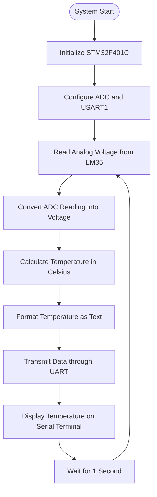

# 🌡️ UART-Based Temperature Monitoring Using STM32F401C and LM35

## 📌 Project Overview

The **UART-Based Temperature Monitoring Using STM32F401C and LM35** is an embedded systems project designed to measure temperature using an analog temperature sensor and transmit the measured values to a computer through UART serial communication.

The system uses an STM32F401C microcontroller to acquire temperature-related voltage readings from an LM35 sensor. The microcontroller converts the analog signal into a digital value using its Analog-to-Digital Converter (ADC), calculates the corresponding temperature in degrees Celsius, and transmits the result through UART.

The project demonstrates sensor interfacing, ADC-based data acquisition, embedded C programming, and serial communication. The firmware is intended to be developed using **STM32CubeIDE**.

## 🎯 Objectives

- Measure ambient temperature using an LM35 sensor.
- Interface an analog sensor with the STM32F401C microcontroller.
- Convert analog sensor voltage into digital readings using the ADC.
- Calculate temperature in degrees Celsius.
- Transmit temperature readings through UART serial communication.
- Display temperature measurements using computer-based serial terminal software.
- Demonstrate embedded systems programming and microcontroller peripheral configuration.

## ⚙️ Components Used

| Component                    | Purpose                                                              |
| ---------------------------- | -------------------------------------------------------------------- |
| STM32F401C Development Board | Main microcontroller                                                 |
| LM35 Temperature Sensor      | Measures temperature and generates an analog voltage                 |
| USB Cable                    | Programming and power, depending on the development board            |
| Jumper Wires                 | Establish electrical connections                                     |
| Computer                     | Firmware development and temperature monitoring                      |
| STM32CubeIDE                 | Embedded firmware development                                        |
| Serial Terminal Software     | Displays temperature readings                                        |
| USB-to-UART Adapter          | Optional, if the board does not expose the selected UART through USB |

## 🔌 Pin Connections

The following table describes the proposed connections. Verify the exact pin mapping for your development board before wiring.

### LM35 Sensor Connections

| LM35 Pin | STM32F401C Connection   | Function                      |
| -------- | ----------------------- | ----------------------------- |
| VCC      | Compatible power supply | Powers the temperature sensor |
| VOUT     | PA0 (ADC input)         | Analog temperature signal     |
| GND      | GND                     | Common ground                 |

### UART Connections

| UART Signal | STM32F401C Pin | Function                       |
| ----------- | -------------- | ------------------------------ |
| USART1 TX   | PA9            | Transmits temperature readings |
| USART1 RX   | PA10           | Receives serial data           |

**Hardware note:** The proposed configuration uses PA0 as an ADC input and PA9/PA10 for USART1. Confirm that these pins are available and configured correctly on your particular STM32F401C board. Verify the LM35 variant's supply requirements and ensure its output voltage remains within the STM32 ADC input limits.

If an external USB-to-UART adapter is used, connect TX to RX and RX to TX, with a common ground and compatible logic levels.

## 🖼️ Circuit Diagram

The circuit connects the LM35 temperature sensor to an ADC input of the STM32F401C. The microcontroller processes the sensor reading and transmits the calculated temperature to a computer through UART.
## 🔁 Circuit Flow and Data Processing

The system follows a sequence of sensing, signal conversion, data processing, and serial communication to monitor temperature continuously.

### 📊 System Flowchart



### ⚡ Step-by-Step Circuit Flow

**1. 🌡️ Temperature Sensing**

The LM35 senses the surrounding temperature and generates an analog output voltage proportional to the measured temperature.

**2. 🔌 Analog Signal Input**

The sensor's output pin is connected to PA0, configured as an ADC input on the STM32F401C. The sensor and microcontroller share a common ground.

**3. 🔢 Analog-to-Digital Conversion**

The STM32F401C ADC converts the analog voltage into a digital value. In the proposed configuration, the ADC uses 12-bit resolution, producing readings from 0 to 4095.

**4. 🧮 Temperature Calculation**

The firmware converts the ADC reading into voltage and calculates the temperature using the LM35's nominal sensitivity of 10 mV/°C.

**5. 📡 UART Communication**

The calculated temperature is formatted into a readable text message and transmitted through USART1 TX, proposed on PA9.

**6. 💻 Serial Monitoring**

The computer receives the transmitted data through a compatible serial interface. A serial terminal displays the temperature in degrees Celsius.

**7. 🔄 Continuous Operation**

After a short delay, the microcontroller repeats the measurement and transmission process, providing regularly updated temperature readings.

### 🔗 Complete Signal Flow

```text
       ┌──────────────────────┐
       │   Ambient Temperature │
       └──────────┬───────────┘
                  ▼
       ┌──────────────────────┐
       │   LM35 Sensor         │
       │ Temperature to Voltage│
       └──────────┬───────────┘
                  │ Analog Signal
                  ▼
       ┌──────────────────────┐
       │ STM32F401C ADC        │
       │ PA0                   │
       └──────────┬───────────┘
                  │ Digital Value
                  ▼
       ┌──────────────────────┐
       │ Temperature           │
       │ Calculation           │
       └──────────┬───────────┘
                  │ Temperature in °C
                  ▼
       ┌──────────────────────┐
       │ USART1 UART           │
       │ TX: PA9               │
       └──────────┬───────────┘
                  │ Serial Data
                  ▼
       ┌──────────────────────┐
       │ Computer Serial       │
       │ Terminal              │
       └──────────┬───────────┘
                  ▼
          Display Temperature
```

**Note:** The flowchart represents the intended firmware operation. The pin assignments and peripheral configuration must be verified against the actual STM32F401C development board.


*Figure 1: Conceptual circuit diagram and system architecture.*

## 🔄 Working Principle

1. **Temperature Sensing:** The LM35 senses the surrounding temperature and generates a proportional analog voltage.
2. **Analog-to-Digital Conversion:** The STM32F401C reads the sensor voltage using its ADC peripheral.
3. **Temperature Calculation:** The firmware converts the ADC reading into voltage and calculates the corresponding temperature.
4. **UART Transmission:** The calculated temperature is formatted as text and transmitted through UART.
5. **Serial Monitoring:** A computer receives the transmitted data and displays the temperature using serial terminal software.
6. **Continuous Monitoring:** The process repeats periodically to provide updated temperature readings.

## 🧮 Temperature Calculation

The LM35 has a nominal sensitivity of **10 mV/°C**.

The temperature can be calculated using:

**Temperature (°C) = Sensor Output Voltage (V) × 100**

For a 12-bit ADC with a reference voltage of 3.3 V:

**ADC Voltage = ADC Reading × 3.3 / 4095**

Therefore:

**Temperature (°C) = ADC Reading × 3.3 × 100 / 4095**

This calculation assumes a 12-bit ADC and an actual reference voltage of 3.3 V. Measurement accuracy depends on the sensor, ADC configuration, reference voltage, and calibration.

## 💻 Software Requirements

- STM32CubeIDE
- Embedded C programming
- STM32 HAL libraries
- STM32CubeMX peripheral configuration tools integrated into STM32CubeIDE
- Serial terminal software
- Compatible STM32F401C development board

## ⚙️ Firmware Configuration

The firmware requires the following peripheral configurations:

| Peripheral | Configuration                                   | Purpose                                |
| ---------- | ----------------------------------------------- | -------------------------------------- |
| ADC        | 12-bit resolution, appropriate analog input     | Reads the LM35 output                  |
| USART1     | 9600 baud, 8 data bits, no parity, 1 stop bit   | Transmits temperature readings         |
| GPIO       | Appropriate analog and alternate-function modes | Connects the sensor and UART interface |

The serial configuration shown is a proposed setting. The firmware and terminal must use matching communication parameters.

## ▶️ How to Run the Project

1. Install STM32CubeIDE.
2. Create a project for your exact STM32F401C microcontroller or development board.
3. Configure the ADC input connected to the LM35.
4. Configure the UART peripheral and its corresponding GPIO pins.
5. Connect the LM35 according to the verified circuit diagram.
6. Implement the temperature conversion and UART transmission code.
7. Compile the firmware and program the microcontroller.
8. Connect the board to the computer.
9. Open a serial terminal and select the correct COM port.
10. Set the terminal to match the configured UART parameters.
11. Run the firmware and observe the temperature readings.

**Note:** The source code must be integrated into the STM32CubeIDE-generated project with the required peripheral initialization functions and configuration files.

## 📟 Expected Serial Monitor Output

After successful implementation, the serial terminal should display temperature readings in a format similar to:

```text
UART Temperature Monitoring System
Sensor: LM35

Temperature: 25.0 C
Temperature: 25.2 C
Temperature: 25.1 C
Temperature: 25.3 C
```

These values are illustrative examples of the intended output, not experimentally verified measurements.

## 🌍 Applications

- Embedded temperature monitoring
- Educational microcontroller laboratories
- Analog sensor interfacing demonstrations
- Electronic equipment temperature observation
- Serial data acquisition systems
- Environmental monitoring prototypes
- Development of more advanced temperature monitoring systems

## 🚀 Future Improvements

- Add an LCD or OLED display for local temperature monitoring.
- Develop a graphical interface for real-time temperature visualization.
- Store temperature measurements in CSV files for analysis.
- Introduce configurable temperature thresholds and alerts.
- Add wireless monitoring using an ESP32 or compatible communication module.
- Implement filtering to reduce measurement fluctuations.
- Calibrate the system against a reference thermometer.

## ⚠️ Limitations and Safety

- The measured accuracy depends on the LM35 variant, ADC reference voltage, sensor tolerance, and calibration.
- The selected UART pins must match the development board's hardware configuration.
- The LM35 supply voltage must comply with its datasheet.
- The sensor output must remain within the STM32 ADC input-voltage limits.
- Actual hardware testing is necessary to verify the system's performance.

This project is intended for educational and prototyping purposes.

## 📚 References

- [STMicroelectronics STM32 Documentation](https://www.st.com/en/microcontrollers-microprocessors/stm32f401.html)
- [Texas Instruments LM35 Datasheet](https://www.ti.com/product/LM35)
- [STM32CubeIDE](https://www.st.com/en/development-tools/stm32cubeide.html)
- [STM32CubeF4 Firmware Package](https://www.st.com/en/embedded-software/stm32cubef4.html)

## 👨‍💻 Author

Rayan

Electronics and Communication Engineering (ECE)

---

⭐ If you find this project useful, consider giving the repository a star!
